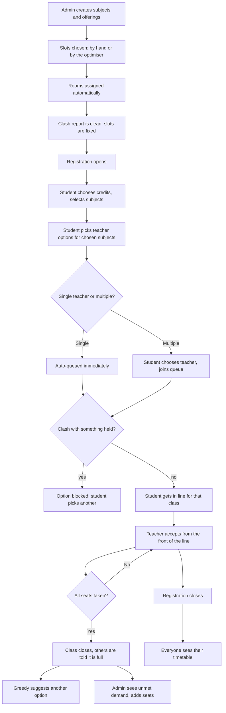
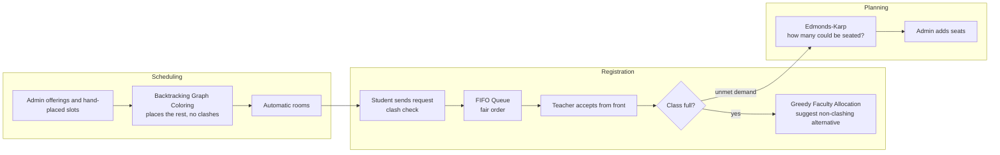

# How the System Works — A Complete Walkthrough

This document explains the College Scheduling Management System **from start to finish**, for anyone — whether or not you
write code. Parts 1–5 describe the idea, the people and the journey. Part 6 explains the four algorithms: **what each
one is for, why it was chosen, and how it works**, with small worked examples. Technical notes are marked
*(for developers)* and can be skipped.

For installation, see [SETUP.md](SETUP.md). For a short project overview, see [README.md](README.md).

## Table of Contents

1. [The big picture](#1-the-big-picture)
2. [Slots, offerings and subject types](#2-slots-offerings-and-subject-types)
3. [The three roles](#3-the-three-roles)
4. [The full journey, step by step](#4-the-full-journey-step-by-step)
5. [What happens in special situations](#5-what-happens-in-special-situations)
6. [The four algorithms](#6-the-four-algorithms)
   - [6.1 FIFO Queue](#61-fifo-queue--the-fair-waiting-line)
   - [6.2 Greedy Faculty Allocation](#62-greedy-faculty-allocation--find-me-the-best-option-right-now)
   - [6.3 Backtracking Graph Coloring](#63-backtracking-graph-coloring--placing-every-class-without-a-clash)
   - [6.4 Edmonds-Karp Maximum Flow](#64-edmonds-karp-maximum-flow--how-many-students-can-we-seat)
7. [How everything fits together](#7-how-everything-fits-together)
8. [Guarantees: fairness and safety](#8-guarantees-fairness-and-safety)
9. [Notifications](#9-notifications)
10. [Glossary](#10-glossary)
11. [Frequently asked questions](#11-frequently-asked-questions)

---

## 1. The big picture

Every term, a college has to answer two questions:

1. **When and where does each class meet?** (scheduling)
2. **Who studies which subject with which teacher?** (registration)

The system is built around the first question, because the second only works once the first is answered well. In an
FFCS-style college, every class is placed in a **slot** *before* students register, so students can see exactly what
they are choosing and can never pick two classes that overlap. Placing hundreds of classes so that no teacher,
no student group and no room is ever double-booked is a hard puzzle — that is the job of the **scheduling optimiser**.

Registration stays as simple as in real life: students pick credits and subjects, choose a teacher's offering, and teachers
accept requests in the order they arrived. Four classic algorithms work underneath:

| Real-life task | Helper working underneath |
|---|---|
| Placing every class into slots without any clash | **Backtracking Graph Coloring** (the scheduling optimiser) |
| Handling requests *in the order they arrived* | **FIFO Queue** |
| Steering a student to another teacher when their choice is full | **Greedy Faculty Allocation** |
| Telling management how many students could be seated and where seats are short | **Edmonds-Karp Maximum Flow** |

> **Important principle:** the algorithms *assist* people; they never silently override them. The admin can place any class
> by hand and the optimiser keeps it where it is. A student's chosen teacher is respected unless that class is full. Teachers
> always accept in arrival order. The "how many could we seat" analysis is advice — it never changes who is enrolled.

## 2. Slots, offerings and subject types

**Slot.** A slot is a named weekly package of meeting periods. For example theory slot `A1+TA1` means *Monday 08:00, Wednesday
09:00 and Friday 10:00*; lab slot `L1+L2` means *Monday 08:00–09:40* (two lab periods in a row). Slots follow the familiar
FFCS chart: theory slots come in "morning" (`…1`) and "afternoon" (`…2`) families, a 3-credit subject uses a slot like
`A1+TA1`, a 4-credit subject one like `A1+TA1+TAA1`, a 2-credit subject just `A1`, and a lab uses a pair like `L3+L4`.

**Clashing is about time, not names.** Two slots clash when any of their periods overlap in time. `A1+TA1` (Mon 08:00)
and lab `L1+L2` (Mon 08:00–09:40) are different slots but overlap, so a student cannot hold both; `F1` (Mon 09:00–09:50) also
overlaps `L1+L2` because lab period `L2` runs 08:51–09:40.

**Offering.** An offering is *one teacher teaching one subject*, as a complete package with **its own slots**. For a
theory-only subject that is one theory slot. For a **theory+lab** subject it is a *pair*: that teacher's theory slot **and** that
teacher's lab slot. A student who chooses the teacher gets exactly that pair — it is impossible to take one teacher's theory
with another teacher's lab. Different teachers of the same subject have different pairs (some may even share a lab slot, in
which case they use different lab rooms).

**Alternatives.** Different subjects placed in the same slot are alternatives: a student can hold only one of them. The admin's
*Slot Chart* and the student's *Slot View* show exactly which subjects share a slot.

**Subject types.** All students can pick from any subject. Most subjects have just **one teacher** (one offering); a few subjects are offered with **several teacher options** (e.g. Calculus with 4 teachers). When a student picks a subject with a single teacher option, they are **auto-queued** immediately. When there are multiple options, they choose which teacher to queue for.

## 3. The three roles

Each person has their own login and sees only their own screens. These limits are enforced by the server, not just
hidden in the interface.

### Management (Admin)
- Create **subjects** (theory credits, lab credits) and **offerings** (teacher + slots + seats).
- Choose slots by hand — the teacher list **only shows teachers who are free** in those slots — or press **Auto-assign slots**.
- Add rooms (only type and size). Rooms are assigned to classes **automatically**.
- See the **Slot Chart**, the **Clash report** and the weekly timetable.
- **Open and close** registration; set the minimum/maximum credits.
- Watch seats and queues; read **alerts**; see **unmet demand** and add seats where needed.
- Use **Algorithm Insights** to see what each algorithm does on the live data (demonstration only).

### Faculty (Teachers)
- See **only their own classes**: slots, rooms, seats, who is enrolled.
- See students who asked to join, **in the exact order they asked**; **accept** or decline the next one; close a class.
- See their own weekly timetable.

### Students
- Choose how many **credits** they will take (within the allowed range).
- Select subjects from any in the college, then choose a teacher **option** — each option shows its slots and tells you if it **clashes** with something you hold. Single-teacher subjects are **auto-queued** immediately.
- Use **Slot View** to compare everything by slot.
- Follow their requests (with their place in line), get **notified**, see their personal timetable.

## 4. The full journey, step by step



### Step 1 — Admin sets up subjects and offerings
The admin creates subjects (for example *BCSE202L – Data Structures and Algorithms, 3 theory + 1 lab credits*) and the standard
slot chart. Then, for each subject, the admin adds **faculty options**: choose the theory slot (and the lab slot for theory+lab
courses), and the **teacher list filters itself** — a teacher already teaching at an overlapping time simply isn't listed. A small
note ("2 teachers not listed — why?") names each one and the class that blocks them. Alternatively the admin adds the teacher and
leaves the slots empty for the optimiser.

### Step 2 — The optimiser places everything else
On the **Scheduling** page, **Auto-assign slots** places every offering that has no slot yet (see §6.3). It never moves classes
the admin placed by hand, and if it cannot find a clash-free placement it says so and **saves nothing**. Rooms are then assigned
automatically from the slots. The **Clash report** confirms nothing is double-booked, and the **Slot Chart** shows what is in each
slot — including which subjects share a slot (alternatives). Once students start registering, classes with students become
**locked** (their slot can no longer be changed), so nobody is silently put into a clash.

### Step 3 — Students choose credits and subjects
A student chooses a **credit load** within the allowed range (for example 16–27) and selects subjects up to that credit total.
They can select any subject the college offers (no restrictions by programme or semester). A student cannot select the same
subject twice.

### Step 4 — Students choose teacher options (auto-queue for single-faculty)
For each selected subject, the student sees the **options**:
- **Single teacher:** the student is **auto-queued immediately** (joined the waiting line automatically).
- **Multiple teachers:** each with their slot(s), times, seats and queue length. An option that overlaps in time with something the student
already holds is **marked and cannot be requested** (the message names the clashing subject and the exact times that conflict).
One option is marked **Suggested** (see §6.2). The student sends a **join request** for their chosen teacher; it is stamped with its
arrival and **placed at the back of that teacher's waiting line**, and the student sees their position ("#3 in the queue").

### Step 5 — Teachers accept in order
The teacher opens the class and sees the line: #1, #2, #3… Only the person at the **front** can be accepted or declined. Accepting
a student gives them a seat, marks them *Enrolled*, and notifies them. The teacher cannot skip ahead or reorder the line.

### Step 6 — The class fills up
When the last seat is taken the class **closes itself automatically**:
- It shows as **FULL**, and no further requests are accepted.
- Everyone still waiting is **rejected in line order and notified** — with a suggestion of another teacher who still has a seat
  *and does not clash with their other classes*.
- If **no teacher** has seats left for that subject, **the admin is alerted**.

### Step 7 — Admin reviews demand and adds seats
On **Demand & Waitlist** the admin sees, per subject: how many students want it, how many are enrolled, waiting, and how many have
**no seat at all**. The admin raises seats where needed. When seats are added to a full class it **reopens automatically**, and the
teacher and every student still without a seat for that subject are notified. The admin can also run the **Maximum Flow** analysis
(§6.4) to learn how many waiting students could be seated, and which classes are the bottleneck.

### Step 8 — Registration closes; timetables
The admin closes registration (students are notified; it can be reopened). Every person's **timetable is derived from the slots**:
students see their enrolled classes' theory and lab periods with rooms; teachers see their classes; the admin sees everything.
There is nothing to "generate" at the end — the schedule was fixed in Steps 1–2 and verified clash-free.

## 5. What happens in special situations

| Situation | What the system does |
|---|---|
| A student requests an offering that **overlaps in time** with one they hold | Refused immediately, showing which subject clashes and the exact times (theory or lab session, day and time). The student picks another option (Slot View shows which). |
| A student requests an offering that has **no slot yet** | Refused ("not scheduled yet"); students can only request placed offerings. |
| A student requests a **full** class | Refused with a clear message, recorded in their history, and a suggested non-clashing alternative is shown. If nobody has seats, the admin is alerted. |
| A student selects a subject with a **single teacher** | They are **auto-queued immediately** (no choice needed) with a position notification. |
| Admin picks a slot for a teacher who is **busy then** | The teacher is not in the list; if the request is forced through the API it is refused (`FACULTY_CLASH`). |
| Admin picks a theory slot that **overlaps its own lab** slot | Refused (the pair would clash with itself). |
| Admin picks a slot with the **wrong credit value** (e.g. a 4-credit slot for a 3-credit subject) | Refused; only matching packages are offered. |
| Admin changes the slot of a class that has **students or waiting requests** | Refused (`SLOT_LOCKED`) to protect those students. |
| No room of the right type/size is free for a placement | Refused (`NO_ROOM`); add a room or choose another slot. |
| The optimiser **cannot** place everything | It reports why (too few slots or rooms for the rules) and **saves nothing**. |
| Two students request at the very same moment | The system takes them strictly one at a time for that class, so the order is always clear. |
| Two actions race for the **last seat** | Only one succeeds. The seat count can never go above capacity — protected by the database itself. |
| A teacher tries to accept someone **not at the front** | Refused: requests must be handled first-come, first-served. |
| A teacher **declines** the front student | That student is notified (with a suggestion if possible) and can choose another teacher. |
| A teacher **closes** a class early | Waiting students are rejected and notified; no new requests are accepted. Faculty can request the admin to **reopen** a closed class. |
| A teacher **requests reopening** a closed class | Admin sees the request and can approve it (class reopens with expanded capacity or fresh enrollment) or decline it. |
| A student **cancels** a waiting request | The request is withdrawn and they may choose another teacher. |
| A student wants **two requests for one subject** | Not allowed — one live request per subject. Cancel first, then choose again. |
| Registration is **closed** | Students cannot change credits, pick or drop subjects, or send new requests until it is reopened (cancelling a waiting request is still allowed). |
| Admin sets seats **below** the number already enrolled | Refused — you cannot take seats away from enrolled students. |
| The server **restarts** | Nothing is lost: slots, queue order and seat counts live in the database. |
| Someone opens a page for another **role** | Blocked — both hidden in the interface and refused by the server. |

## 6. The four algorithms

An *algorithm* is a precise, step-by-step method for solving a problem. Here is each of the four, with the same layout:
**what it is for → why this one → how it works → where you can see it.**

---

### 6.1 FIFO Queue — the fair waiting line

#### Purpose
To make sure requests to join a class are handled **strictly in the order they arrived** — first come, first served.
This is the college's rule, and a queue enforces it mechanically.

#### Why this algorithm
Fairness is the whole requirement, so the data structure should make unfairness *impossible*, not merely discouraged.
A **queue** (FIFO = *First In, First Out*) is exactly a waiting line: new items join at the back, items leave only from the
front. There is no operation for cutting in line. It is also extremely fast: joining and leaving the line each take one
step, no matter how long the line is (**O(1)**).

#### How it works
Think of a shop counter:

1. A student sends a request → they **join the back** of that class's line.
2. The teacher accepts → the person at the **front** leaves the line and gets the seat.
3. Nobody can be moved, sorted or jumped.

**Example.** Dr. Rao's class has 2 seats. Anna, Ben, Chen and Dev request in that order, so the line is
`Anna → Ben → Chen → Dev`.
- Teacher accepts → **Anna** enrolled. Line: `Ben → Chen → Dev`. (1 seat left)
- Teacher accepts → **Ben** enrolled. Seats are now full. The class closes, and the line `Chen → Dev` is cleared in order —
  Chen is told first, then Dev — each with a "class is full, try another teacher" message.

**Keeping the line safe.** A line held only in the computer's memory would vanish on a restart or differ between servers. So the
line is stored permanently: every request gets a **sequence number** for its class (1, 2, 3, …) assigned at the moment it
joins. The system rebuilds the line from those numbers whenever needed, so order survives restarts and stays identical
everywhere. The teacher's screen shows the line, but the *server* decides the order.

#### Where you can see it
- Teacher: *My Classes → open a class* — "Pending requests — first come, first served"; only row #1 has buttons.
- Student: *Request Status* — "Position #3 in the queue".
- Admin: *Algorithm Insights → FIFO Queue* — the line before processing, who would be accepted in order, who would be turned away.

*(For developers)* `backend/app/algorithms/fifo_queue.py` (a `collections.deque`); persisted ordering via `join_requests.queue_seq`;
used by `registration_service` (enqueue) and `faculty_service` (dequeue). Enqueue/dequeue/peek are O(1).

---

### 6.2 Greedy Faculty Allocation — "find me the best option right now"

#### Purpose
When a student's chosen teacher is full, quickly pick the **best other option that still has a seat** — so the student isn't left
searching manually. It is used for the **Suggested** badge, the "try this teacher instead" message, and the notification texts.

#### Why this algorithm
A *greedy* algorithm makes the best choice available **right now** and doesn't go back to reconsider. That is exactly what we
want here: a decision that is instant, easy to explain ("this teacher has the most free seats"), and doesn't reshuffle
anyone who was already placed. Reconsidering everyone each time would be slower, confusing, and unfair to people already
settled. It is also completely predictable — the same situation always gives the same answer.

> It is deliberately **not** a clever hidden optimiser. It is a clearly stated rule. And it only *suggests*: the student always
> makes the actual choice, so their own decision is never overridden.

#### How it works
1. **Discard** every option that is closed, full, **not yet scheduled, or overlapping in time with a class the student already holds**.
2. **Rank** the rest using a prioritised list of preferences — the first one that differs wins:
   1. **Is it the teacher the student chose?** (their own choice always comes first, as long as it is available)
   2. **Does it avoid clashing with the student's classes?** (already guaranteed by step 1; kept as a documented tie-breaker)
   3. **More free seats** is better.
   4. **Shorter waiting line** is better.
3. Still tied? Pick the lowest class number, so the answer is always the same.
4. Look at each option **once** — no going back.

**Example.** The student wanted Rao (full). Alternatives for the same subject:

| Teacher | Free seats | People waiting | Overlaps with the student's classes? |
|---|---|---|---|
| Iyer | 3 | 1 | no |
| Nair | 7 | 0 | **yes → discarded** |
| Khan | 0 | 0 | *(full — discarded)* |
| Das | 5 | 2 | no |

Nair is discarded because of the clash, Khan because he is full. Among Iyer (3 free) and Das (5 free) the free-seats rule picks
**Das**. If the student's own choice had been Iyer and Iyer had a seat, **Iyer would win regardless**.

#### Where you can see it
- Student: a **Suggested** badge on the options list; the suggestion shown in a "class is full" message.
- Admin: *Algorithm Insights → Greedy* — every candidate with its score and the one selected, plus the reasoning.

*(For developers)* `backend/app/algorithms/greedy_faculty_allocation.py`; glue in `allocation_service.py`. One linear scan,
**O(F)** for F candidate faculties (O(F log F) only when producing the sorted display list).

---

### 6.3 Backtracking Graph Coloring — placing every class without a clash

#### Purpose
To give every class a **slot** so that **nothing clashes**: no teacher is in two overlapping classes, a class's theory never overlaps
its own lab, and no more classes meet at the same time than there are rooms. Where there is a choice, it also **spreads subjects
apart** so students have better chances of combining them without clashing.

#### Why this algorithm
A schedule is a puzzle, and it maps perfectly onto a well-known problem called **graph coloring**:

- Draw a dot for every class (theory and lab count as separate dots).
- Draw a **line between two dots that must not overlap in time**.
- Imagine each slot is a **colour**.
- The goal: colour every dot so that **dots joined by a line never get overlapping slots**.

Why *backtracking*? Because a simple "grab the first slot that fits" can paint itself into a corner late in the process.
**Backtracking** is the careful solver's method: try a slot, move on, and if you later hit a dead end, **undo recent choices and
try something else** — exactly how you solve a Sudoku. It will find a clash-free placement whenever one exists and can honestly
report "impossible" when none does.

#### How it works

**Step 1 — Build the clash map from real data.** Two parts get a line ("must not overlap") if they belong to the **same teacher** or are
the **theory and lab of the same offering**. Multiple subjects taught by the same teacher also get lines to prevent teacher clashes.

**Step 2 — Give each part its choices.** A 3-credit theory part may only use 3-credit theory slots; a lab part only lab slots.
Classes the admin already placed are fixed: they are kept exactly as they are and simply block their slots.

**Step 3 — Place with backtracking.** Take the parts in order of **most "must-not-overlap" lines first** (the hardest are placed while
there is still freedom). For each part try the available slots, best first:
1. Does the slot **overlap in time** with any already-placed neighbour? → skip it.
2. Would it use more rooms than exist at that time? → skip it.
3. Otherwise **place** the part there (preferring the least-used slot for better spread) and move on.
4. If a later part has *no* slot that works, **go back**, undo this placement, and try the next slot.

**Step 4 — Assign rooms and double-check.** Within each time every class gets a room of the right type (lecture hall or lab) and
size that nobody else uses then. The result is then verified again for clashes before it is saved.

**Worked example.** Three parts: **A** may use slots S1 or S2; **B** may only use S1; **C** may use S2 or S3. A–B must not overlap, and A–C
must not overlap (S1 = Mon 09:00, S2 = Mon 10:00, S3 = Tue 09:00):
- Place **A** → tries S1 first. Place **B** → S1 is its only choice, but it overlaps A. **Dead end** → *backtrack*: undo A.
- Place **A** → S2. Place **B** → S1 ✔. Place **C** → S2 overlaps A, so S3 ✔. Done.

The Admin Insights page reports *whether backtracking was needed* and how many choices were undone.

**Clashes are about time.** Because slots are compared by their periods, the optimiser knows that theory `F1` (Mon 09:00–09:50) cannot sit
with lab `L1+L2` (Mon 08:00–09:40) even though they are different slots.

**Honesty about difficulty.** Graph coloring is a famously hard problem: in the worst case the search can grow exponentially.
Real college data is well-behaved, and the solver uses shortcuts (hardest-first order, pre-placed classes kept fixed, a limited list of
slots per class, a safety limit on effort), so the whole sample data (36 offerings) is placed in a fraction of a second. If no clash-free placement
exists you get a clear message and **nothing partial is saved**.

#### Where you can see it
- Admin: *Scheduling → Auto-assign slots*, the **Clash report**, and the **Slot Chart**.
- Admin: *Algorithm Insights → Backtracking Graph Coloring* — a dry run: the "must not overlap" lines and why each exists, the slots it would pick,
  and whether backtracking happened.
- Teachers and students: their own timetable pages.

*(For developers)* `backend/app/algorithms/backtracking_graph_coloring.py` (`backtracking_slot_assignment`, plus the textbook `backtracking_color` /
`color_with_min_slots` it generalises); the problem is built in `timetable_service.build_problem`; rooms in `room_service`. Worst case
**O(k^V)** for V class parts and k candidate slots, mitigated by highest-degree-first ordering, per-part domains, fixed placements and a step budget.

---

### 6.4 Edmonds-Karp Maximum Flow — "how many students can we seat?"

#### Purpose
To answer management's planning question: **given the seats that exist right now, what is the largest number of waiting
students who could be given a seat — and which classes are the bottleneck?** It reports: total students wanting seats,
the maximum that can be accommodated, how many cannot, and which classes limit the result.

#### Why this algorithm
Matching students to seats with limited capacity, where each student can only go to certain classes, is a textbook
**maximum flow** problem. The idea: imagine water flowing from a source, through students, into classes, and out to a drain
— each pipe has a limit. The most water that can flow equals the most students that can be seated. Maximum flow is
solved *exactly* (no guessing), and it handles tricky cases where a naive approach gets stuck, because it can **reroute earlier
choices** to make room for more people.

**Edmonds-Karp** is the dependable version of the method: it always improves the plan along the **shortest** route available,
which guarantees it finishes in a predictable amount of time.

> It is a **planning tool only**. It never enrols anyone or changes seats. Real acceptance remains first-come,
> first-served, handled by teachers.

#### How it works

**Step 1 — Build the network** (a map of pipes):

```
SOURCE ──▶ each (student, subject) that still needs a seat ──▶ each class of that subject ──▶ DRAIN
 cap 1                         cap 1                                    cap = free seats in that class
```
- Every waiting student–subject pair can use **one** seat (capacity 1 from the source).
- A student connects to every open, scheduled option for that subject **that does not overlap in time with a class they are already
  enrolled in** (capacity 1).
- Each class connects to the drain with a capacity equal to its **free seats**.

**Step 2 — Push flow along shortest paths.** Repeatedly:
1. Search (breadth-first, so shortest first) for any route from source to drain that still has spare capacity.
2. Push as many students along it as the narrowest pipe allows.
3. Update the leftover capacities — including a **reverse "undo" pipe**, so a later search can cancel an earlier choice.
4. Stop when no route remains. The total pushed is the **maximum**.

**Why "undo" matters — example.** Two classes, A and B, each with 1 seat. Student 1 can take A or B; Student 2 can take only A.
A careless approach seats Student 1 in A first and then finds no place for Student 2 — wrongly concluding only 1 can be
seated. Edmonds-Karp notices it can **move Student 1 to B** and put Student 2 in A, so **both** are seated. The reverse pipe is what
makes that swap possible.

**Reading the result.** Suppose 3 students want a subject and two classes have 1 free seat each:
- Total wanting seats: **3**; maximum that can be accommodated: **2**; unaccommodated: **1**.
- Bottleneck classes: **both** — they're completely used, so adding a seat to either would help.

The *bottleneck* classes are found from the "minimum cut" — the saturated pipes that actually limit the result. That is where
extra seats would do the most good. A student whose **only** remaining option clashes with their other classes shows up as
unaccommodated even when seats exist elsewhere — useful to know before adding seats.

#### Where you can see it
- Admin: *Algorithm Insights → Edmonds-Karp Max Flow* — requested, maximum, unaccommodated, per-subject outcome,
  bottleneck classes, an example best allocation, and the students who cannot be seated.
- Each run is logged in the "Algorithm execution status" table.

*(For developers)* `backend/app/algorithms/edmonds_karp.py`; the network is built in `insights_service.max_flow_report`. Edges and
reverse edges are stored in pairs with residual capacities; BFS finds every augmenting path. Worst case **O(V·E²)**.

---

## 7. How everything fits together



| When | Algorithm | Who benefits |
|---|---|---|
| Before registration: placing classes | Backtracking Graph Coloring | Everyone (a clash-free, visible schedule) |
| Student sends a request; teacher accepts | FIFO Queue | Students (fairness), teachers (clear order) |
| A class is full | Greedy Faculty Allocation | Students (quick, non-clashing alternative) |
| Admin plans seats | Edmonds-Karp Max Flow | Management (where to add seats) |

Scheduling comes first because it sets the options students choose from; registration follows; planning supports the admin's
seat decisions in between. Algorithms never skip the normal workflow: people still choose, teachers still accept, the admin still decides.

## 8. Guarantees: fairness and safety

- **Order is always arrival order** — never sorted, never reorderable. It survives restarts.
- **Seats can never be oversold** — protected three ways: the class is locked while it is changed, seats are taken with one
  atomic "only if a seat remains" step, and the database refuses any row where enrolled > capacity.
- **A full or closed class never accepts requests**, and students are told why.
- **No clashes, ever** — a teacher is never in two overlapping slots (checked on every placement), a student can never hold two
  overlapping offerings (checked on every request), a room is never used twice at overlapping times, and the clash report re-checks all of it.
- **A theory+lab offering is one unit** — a student cannot take one teacher's theory with another's lab.
- **One seat, one subject, once** — no double registration, one live request per subject.
- **Slots can't move under students** — an offering with enrolled or waiting students is locked.
- **Same input → same output** — the algorithms are deterministic, so results are reproducible.
- **People only reach what is theirs** — a teacher cannot touch another teacher's class; a student cannot see another student's
  data; only the admin can place slots or change capacity. Enforced by the server.
- **Passwords are never stored in readable form** (they are salted and hashed).

## 9. Notifications

Everyone has an in-app notification list with an unread counter.

| Event | Who is told |
|---|---|
| A student sends a request | The teacher |
| Request accepted | The student |
| Request declined | The student (with a suggestion if possible) |
| Class becomes full | Waiting students; the teacher; the admin |
| Class closed manually | Waiting students; the admin (and the teacher if the admin closed it) |
| No teacher has seats for a subject | The admin (one alert per subject until read, to avoid spam) |
| Seats increased | The teacher and every student still without a seat for that subject |
| Slots assigned by the optimiser | Each affected teacher; the admin (summary) |
| Registration opened / closed | All students |

## 10. Glossary

| Term | Meaning |
|---|---|
| **Slot** | A named weekly package of meeting periods, e.g. `A1+TA1` (theory) or `L1+L2` (lab) |
| **Clash / overlap** | Two slots clash when any of their periods overlap in time |
| **Offering (class)** | One teacher teaching one subject, with its own slot(s) and seats; for theory+lab courses a fixed theory+lab pair |
| **Option course** | A course offered by several teachers (the student picks one offering) |
| **Group** | A student's programme + semester (e.g. CSE-S3); decides which subjects are mandatory |
| **Mandatory / optional** | Mandatory subjects are registered automatically for the whole group; optional ones are chosen by the student |
| **Capacity** | The number of seats in a class |
| **Join request** | A student's request for a seat in a particular offering |
| **Queue / waiting line** | The requests for one class, in arrival order |
| **Enrolled** | The student has a confirmed seat |
| **Unmet demand** | A student who wants a subject but has neither a seat nor a pending request |
| **Locked offering** | An offering with enrolled or waiting students; its slot cannot be changed |
| **Credits** | The weight of a subject (theory + lab credits); each student picks a total load within an allowed range |
| **Graph** | A set of dots (class parts) joined by lines ("must not overlap") |
| **Backtracking** | Try an option; if it leads to a dead end, undo and try another |
| **Greedy** | Always take the best option available right now, without reconsidering earlier choices |
| **Maximum flow** | The largest amount that can be sent through a network of limited-capacity pipes |
| **Bottleneck** | A class whose limited seats hold back the whole result |
| **Complexity (O-notation)** | A measure of how running time grows with the input size. O(1) = constant; O(F) = proportional to F |

## 11. Frequently asked questions

**Why are slots decided before registration instead of after?**
Because students need to see the real options to choose from, and the college must guarantee nobody is booked into two classes at
once. Placing classes first and checking each request against the slots makes clashes impossible rather than something to repair later.

**Can the admin override the optimiser?**
Yes. Any offering can be placed by hand (the server still refuses a placement that would double-book the teacher or overlap its own
lab), and the optimiser only fills in offerings that have no slot. "Clear unlocked slots" lets the optimiser redo everything that has no students.

**Can a teacher accept students out of order?**
No. Only the student at the front of the line can be accepted or declined. The server rejects anything else.

**Does the Maximum Flow analysis change who gets a seat?**
No. It only reports what is theoretically possible. Real seats are given only when a teacher accepts a request.

**Will the system ever move a student to another teacher without asking?**
No. The student only sees a *suggestion*; they decide.

**What if two students click for the last seat at the same instant?**
The system handles them one at a time. One gets the seat; the other is told the class is full. Seats can never go over capacity.

**What if the optimiser cannot place everything?**
You get a message explaining that there are too few slots or rooms for the rules (or a teacher with too many classes). Nothing partial is
saved. Add rooms, spread the teachers' courses, or fix a hand-placed slot, and run it again.

**Why do two optional subjects sometimes share a slot?**
When the rules leave no room to keep them apart (for example a group with many optional subjects and a few free slots). The clash report lists
each such pair; students of that group simply choose one of the two. Mandatory subjects never share time with anything else in their group.

**Why is the Graph Coloring "exponential" if it's fast?**
Hard worst-case inputs exist for every method; this is a property of the problem itself. For real college-sized schedules the ordering and
pruning make it fast, and a safety limit prevents a runaway search.

**Where do I see all this in action?**
Load the sample data (see [SETUP.md](SETUP.md)), sign in as the admin, and open **Slot Chart**, **Scheduling** and **Algorithm Insights**. Then
follow the journey in Part 4 with the sample teacher and student accounts listed in the [README](README.md#sample-data--credentials).
